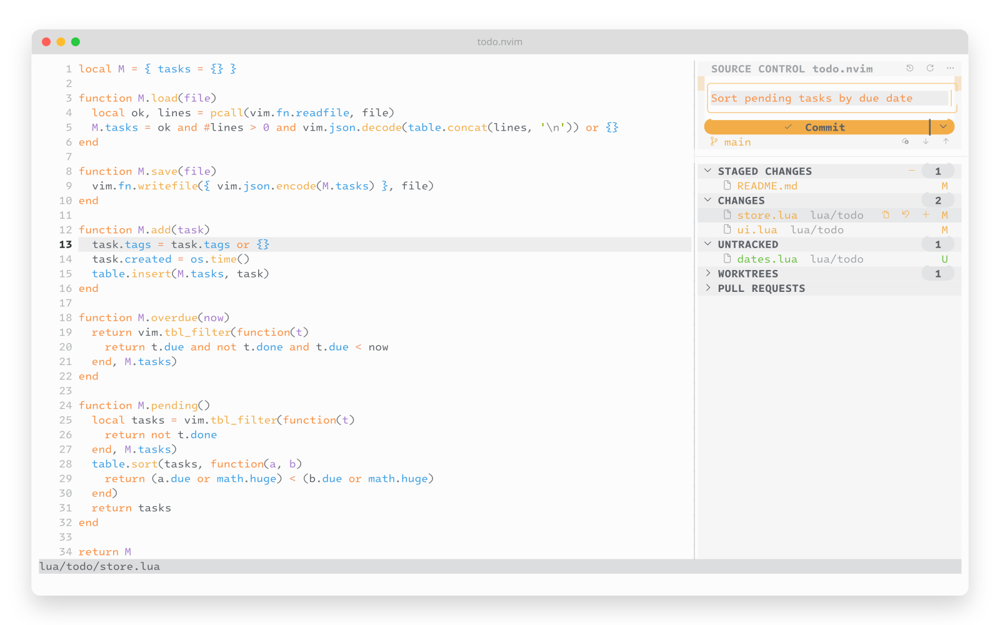
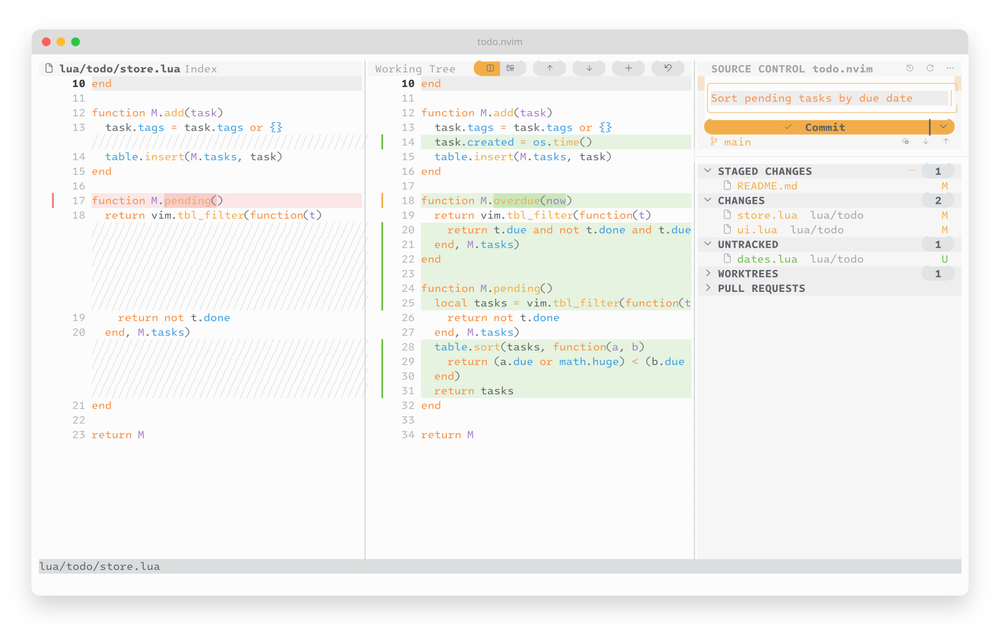
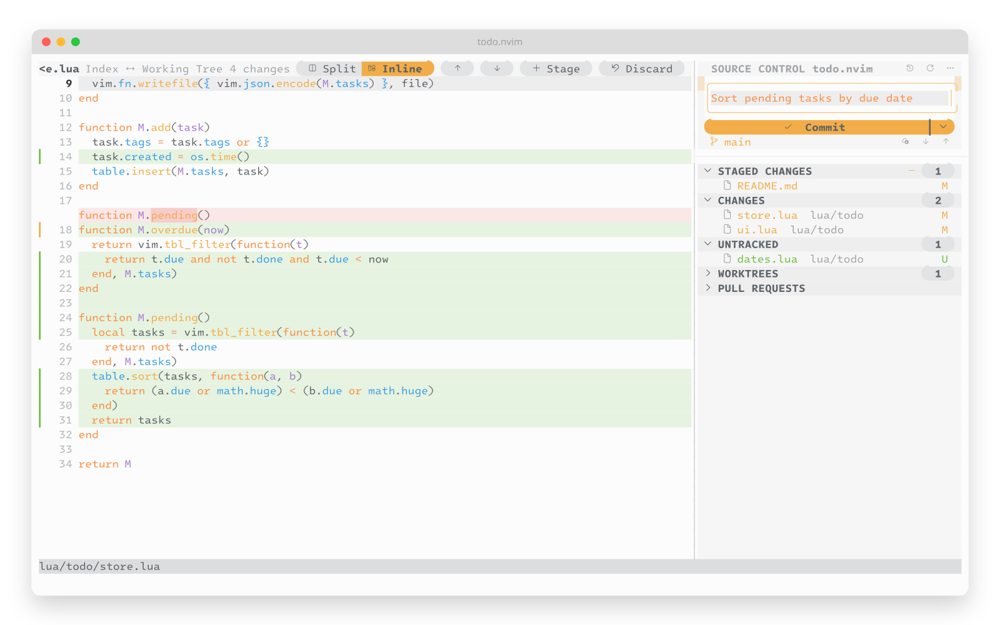
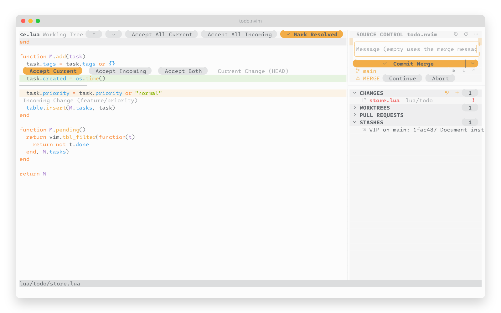
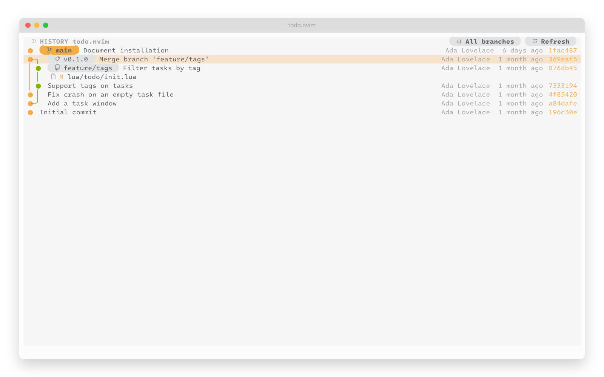
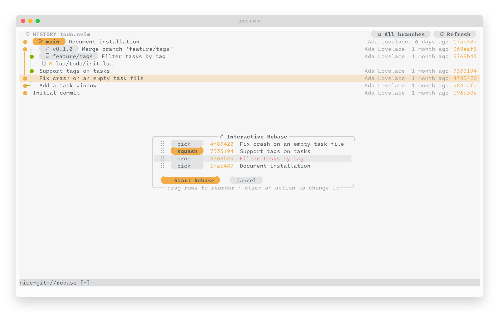
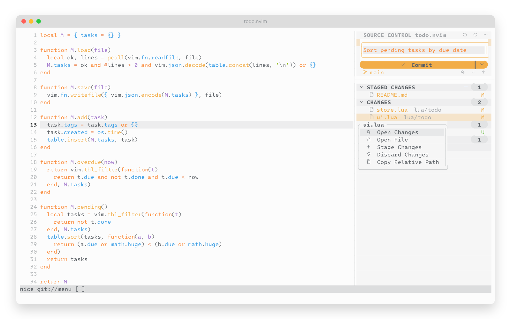

# nice-git.nvim

A Git interface for Neovim that works like VSCode's Source Control view: a panel you can click, full-file diffs you can edit, a commit graph, conflict resolution and interactive rebase. Everything works with the mouse, and every click also has a key.

<picture><source media="(prefers-color-scheme: dark)" srcset="docs/images/panel.png"></picture>

## Features

- **Source Control panel**: stage, unstage and discard with a click or by dragging files between sections; commit from a message box; fetch, pull, push and switch branches.
- **Full-file diffs**: side by side or inline, with syntax colors, word-level highlights, and stage/discard per change. The working-tree side is your real buffer, so you edit right in the diff.
- **Commit graph**: colored branch lines, branch and tag labels, and per-commit file diffs.
- **Conflicts and rebase**: accept current/incoming/both with one click; plan an interactive rebase by dragging commits.
- **Also included**: blame, stashes, worktrees, submodules and GitHub pull requests.
- **One toggle**: `:NiceGit toggle` hides the whole workspace and brings it back exactly as it was.

| Side by side | Inline |
|---|---|
| <picture><source media="(prefers-color-scheme: dark)" srcset="docs/images/diff.png"></picture> | <picture><source media="(prefers-color-scheme: dark)" srcset="docs/images/inline.png"></picture> |
| **Conflicts** | **Commit graph** |
| <picture><source media="(prefers-color-scheme: dark)" srcset="docs/images/conflict.png"></picture> | <picture><source media="(prefers-color-scheme: dark)" srcset="docs/images/history.png"></picture> |
| **Interactive rebase** | **Context menu** |
| <picture><source media="(prefers-color-scheme: dark)" srcset="docs/images/rebase.png"></picture> | <picture><source media="(prefers-color-scheme: dark)" srcset="docs/images/menu.png"></picture> |

## Requirements

- Neovim 0.13+ and git 2.32+
- A [Nerd Font](https://www.nerdfonts.com) (v3+) and `termguicolors`
- Optional: [mini.icons](https://github.com/echasnovski/mini.icons) or [nvim-web-devicons](https://github.com/nvim-tree/nvim-web-devicons) for file icons, [`gh`](https://cli.github.com) for pull requests

## Install

```lua
vim.pack.add({ 'https://github.com/mkrbz/nice-git.nvim' })
```

With lazy.nvim: `{ 'mkrbz/nice-git.nvim', cmd = 'NiceGit', opts = {} }`. More options in [docs/install.md](docs/install.md).

## Quick start

Open a file in a Git repository and run `:NiceGit`. Click a file to see its diff, `+` to stage it, then type a message and click **Commit**.

To switch between your code and nice-git with one key:

```lua
vim.keymap.set('n', '<leader>g', '<cmd>NiceGit toggle<cr>', { desc = 'nice-git' })
```

## Documentation

- [Install](docs/install.md): vim.pack, lazy.nvim, local clones, updating
- [Usage](docs/usage.md): the panel, diffs, conflicts, history, rebase, blame, commands and keys
- [Configuration](docs/configuration.md): options, colors and icons
- [Development](docs/development.md): working on the plugin from a local clone

## License

[MIT](LICENSE)
