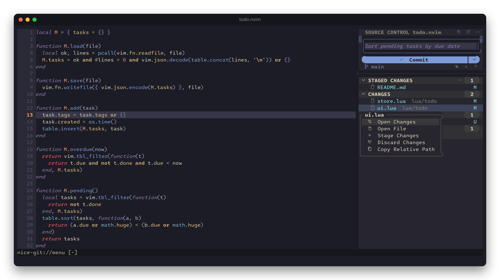

# Usage

## Commands

| Command | |
|---|---|
| `:NiceGit` | Toggle the Source Control panel in the current tab |
| `:NiceGit toggle` | Hide the whole workspace (panels, diff tab, history tab) and bring it back exactly as it was |
| `:NiceGit log` | Commit graph |
| `:NiceGit blame` | Toggle the blame side panel for the current file |
| `:NiceGit blame_line` | Toggle blame text on the cursor line |

There are no default global keys. A useful one:

```lua
vim.keymap.set('n', '<leader>g', '<cmd>NiceGit toggle<cr>', { desc = 'nice-git' })
```

Hiding closes nice-git's windows and tabs but keeps their state. Showing reopens them with the same file,
diff mode and cursor, and returns you to the tab you were in.

## Panel



The header holds the commit message box, a **Commit** button (its `▾` opens Commit (Amend), Commit All,
Edit Last Commit Message and Stash All Changes), and the branch with fetch, pull and push icons. The title bar
has icons for history, refresh and a menu with more actions. Below it, changes are grouped in sections.
Hover a file (or move the cursor to it) to see its buttons; right-click it for a menu.

| Mouse | Key | Action |
|---|---|---|
| click branch name | `b` | switch, create, or track a branch |
| fetch / pull / push icons | `f` / `p` / `P` | sync with the remote |
| history icon (title bar) | `l` | commit graph |
| Commit | `c` (focus message box), then `<C-CR>` or `<C-s>` | commit |
| click file | `<CR>` | open its full-file diff (conflicted files open the conflict view) |
| open-file icon | `o` | open the file itself |
| stage / unstage icon | `-` | stage / unstage the file, or the whole section on its title |
| discard icon | `x` | discard changes (deletes untracked files) |
| drag a file between sections | | stage / unstage |
| right-click | `m` | context menu |
| click section title | `<CR>` | collapse / expand |
| Continue / Skip / Abort | | finish an in-progress merge, rebase, cherry-pick or revert |
| | `R` / `q` | refresh / close |

The panel also has sections for worktrees, submodules, pull requests and stashes. Clicking a worktree or
submodule makes it the active repository for the tab. Pull requests load only when you expand their section.

## Diff view

The diff always shows the whole file. The toolbar's **Split | Inline** switch picks between side by side
(old version on the left, read-only) and inline (removed lines shown in red, with their syntax colors,
above the lines that replaced them; changed words are highlighted). Colored bars in the sign column mark
every change. The working-tree side is your real buffer, so you can edit it directly and the diff updates
as you type.

| Toolbar | Key | |
|---|---|---|
| `↑` / `↓` icons | `[c` / `]c` | previous / next change |
| Stage / Unstage | `<leader>hs` | stage or unstage the change under the cursor |
| Discard | `<leader>hr` | revert the change under the cursor |

## Conflicts

Clicking a conflicted file (`!`) opens it with each conflict highlighted. Click **Accept Current**,
**Accept Incoming** or **Accept Both** on the conflict's first line, or press `co` / `ct` / `cb` / `c0`
(the last one keeps neither side). Then click **Mark Resolved**, and **Continue** in the panel header.

## History and rebase

The graph draws each line of history in its own color, with branches, tags and remotes as labels.
Click a commit to expand its files, and click a file to diff it. Right-click (or `m`) opens a menu with
Show commit, Copy hash and **Interactive rebase from here…**.

In the rebase planner, drag rows to reorder them, click an action (or press `p`/`r`/`e`/`s`/`f`/`d`) to
change it, then click **Start Rebase**. Rewording asks for the new message right there; no editor opens.

## Blame

`:NiceGit blame_line` shows author, age and summary at the end of the cursor line. `:NiceGit blame` opens
a side panel that scrolls with the file; click a line to see that commit. Unsaved edits show as
"Uncommitted".

## Good to know

- Nothing is stored on disk. Credentials come from your git credential helper, SSH agent, or `gh`.
- Pulling without `pull.rebase`/`pull.ff` configured merges, like VSCode does.
- While the panel is visible, `mousemoveevent` is switched on (and restored when it closes) so rows can
  react to hover.
